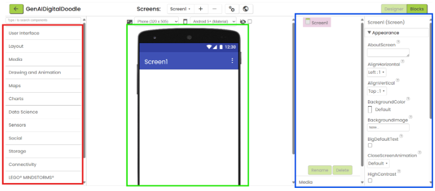
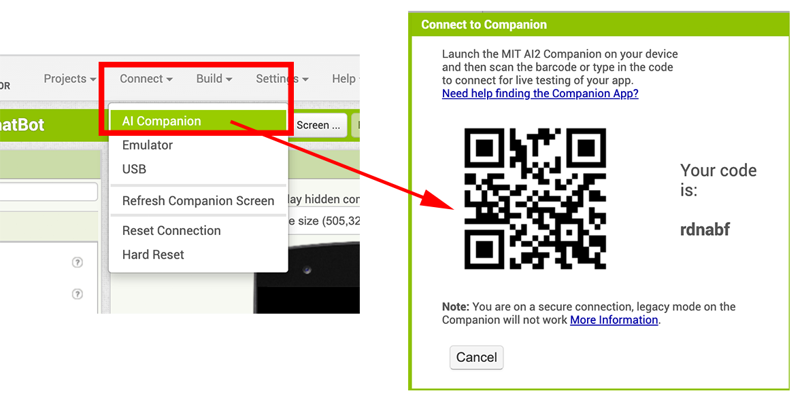

---
title: Emergency App
layout: tutorial
---

# אתגר (Challenge)

אפליקציית החירום (Emergency App) מסייעת למשתמשים להגיב במהירות במצבי סכנה או דחיפות. האפליקציה מציגה מפה לזיהוי מיקום המשתמש/ת, ובזמן אמת יכולה ללכוד ולשתף אותו. בנוסף, ניתן להקליט הודעה, לצלם תמונה ולשלוח אותן יחד עם המיקום לאנשי קשר נבחרים בהודעת טקסט. האפליקציה כוללת גם לחצן חירום המשמיע צליל אזעקה חזק למשיכת תשומת לב והרתעת גורמי סכנה.

<strong>הבהרה! (Disclaimer)</strong>  
מדריך זה מיועד למטרות לימודיות בלבד. אם אתם חווים אירוע חירום אמיתי, אנא פנו מיד לשירותי החירום והרשויות המוסמכות.

{:.enlargeImage}

# הגדרות (Setup)

## מתחילים (Getting Started)

לסיוע בהתקנה והתחלת העבודה עם App Inventor, אנא בקרו בדף <a href="https://appinventor.mit.edu/explore/ai2/setup" target="_blank">Setting Up App Inventor</a> שלנו.

## הכרת מבנה המסך ב-App Inventor

המסך שבו אתם צופים כעת הוא מסך ה-Design. בצד שמאל (במסגרת אדומה) נמצאת ה-Palette, ובה מגירות עם רכיבים שתוכלו להוסיף לאפליקציה. במרכז המסך (במסגרת ירוקה) מוצג ה-Viewer - מסך טלפון ריק שבו תבנו את ממשק המשתמש (UI) של האפליקציה. בצד ימין (במסגרת כחולה) נמצא חלון ה-Properties, שבו תוכלו לערוך מאפיינים ספציפיים של כל רכיב. קחו כמה דקות לחקור את הרכיבים במגירות השונות.

{:.enlargeImage}

# אפליקציית חירום (Emergency App)

## ממשק המשתמש (UI)

מרבית ממשק המשתמש כבר בנוי, אך עלינו להוסיף כמה רכיבים כדי להשלים אותו:

1. ממגירת Maps, גררו והשמיטו רכיב <strong>Map</strong> אל מסך הטלפון לתוך ה-HorizontalArrangement האפור.
{:.enlargeImage}

2. בחלון Properties, שנו את <em>Height</em> ל-Fill parent, את <em>Width</em> ל-Fill parent, ואת <em>ZoomLevel</em> ל-18.
{:.enlargeImage}

3. ממגירת Maps, גררו והשמיטו רכיב <strong>Marker</strong> על גבי ה-Map במסך הטלפון.
{:.enlargeImage}

4. כעת נוסיף רכיבים לא-וויזואליים (non-visible components) הפועלים ברקע. רכיבים אלו לא יופיעו על מסך ה-Viewer, אלא מתחתיו. ממגירת Media, גררו והשמיטו אל מסך הטלפון את הרכיבים <strong>Camera</strong>, <strong>Player</strong>, ו-<strong>SpeechRecognizer</strong>.
{:.enlargeImage}

5. תחת פאנל <strong>Screen1</strong>, בחרו ב-<strong>Player1</strong> ובחלון Properties שנו את Source ל-`AlarmSound.m4a`.
{:.enlargeImage}

6. ממגירת Sensors, גררו והשמיטו רכיב <strong>LocationSensor</strong> אל מסך הטלפון.
{:.enlargeImage}

7. ממגירת Social, גררו והשמיטו רכיב <strong>Sharing</strong> אל מסך הטלפון.
{:.enlargeImage}

## תכנות פונקציונליות הממשק (UI)

בפינה הימנית העליונה של המסך, לחצו על הכפתור Blocks למעבר ללוח התכנות.

{:.enlargeImage}

## תכנות ה-Player

* תחת <strong>EmergencyButton</strong>, גררו את הבלוק `when EmergencyButton.Click` אל סביבת העבודה.
{:.enlargeImage}

* תחת <strong>Player1</strong>, גררו את `call Player1.Start` וחברו אותו לתוך הבלוק `when EmergencyButton.Click`.
{:.enlargeImage}

* תחת <strong>ResetButton</strong>, גררו את הבלוק `when ResetButton.Click` אל סביבת העבודה.
{:.enlargeImage}

* תחת <strong>Player1</strong>, גררו את `call Player1.Stop` וחברו אותו לתוך הבלוק `when ResetButton.Click`.
{:.enlargeImage}

## הגדרת משתני קו רוחב וקו אורך (Latitude & Longitude)

1. תחת <strong>Variables</strong>, גררו את הבלוק `initialize global name to` אל סביבת העבודה.
{:.enlargeImage}

2. שנו את השם `name` ל-`latitude`.
{:.enlargeImage}

3. תחת <strong>Text</strong>, גררו בלוק מחרוזת ריקה `""` וחברו אותו אל הבלוק `initialize global latitude to`.
{:.enlargeImage}

4. חזרו על אותם צעדים כדי להגדיר משתנה נוסף בשם `longitude`.
{:.enlargeImage}

## קבלת מיקום (Get Location)

* תחת <strong>GetLocationButton</strong>, גררו את הבלוק `when GetLocationButton.Click`.
{:.enlargeImage}

* תחת <strong>Variables</strong>, גררו את הבלוק `set to`, חברו אותו לתוך `when GetLocationButton.Click`, ובחרו ב-`global latitude`.
{:.enlargeImage}
{:.enlargeImage}

* תחת <strong>LocationSensor1</strong>, גררו את הבלוק `LocationSensor1.Latitude` וחברו אותו אל `set global latitude to`.
{:.enlargeImage}

* חזרו על הפעולה עבור `global longitude`: חברו את הבלוק `set to` ובחרו ב-`global longitude`, ולאחר מכן חברו אליו את `LocationSensor1.Longitude`.
{:.enlargeImage}
{:.enlargeImage}
{:.enlargeImage}

* תחת <strong>LocationSensor1</strong>, גררו את הבלוק `LocationSensor1.ReverseGeocode` וחברו אותו לתוך `when GetLocationButton.Click`. פונקציית Reverse Geocode משמשת לקבלת הכתובת הפיזית בהינתן קואורדינטות קו הרוחב וקו האורך.
{:.enlargeImage}

* תחת <strong>Variables</strong>, חברו בלוקי `get` של `global latitude` ו-`global longitude` לשדות המתאימים בבלוק `LocationSensor1.ReverseGeocode`.
{:.enlargeImage}
{:.enlargeImage}

* עדכון התוויות במסך: תחת <strong>LattitudeLabel</strong>, חברו את `set LattitudeLabel.Text to` ל-`get global latitude`. תחת <strong>LongitudeLabel</strong>, חברו את `set LongitudeLabel.Text to` ל-`get global longitude`.
{:.enlargeImage}
{:.enlargeImage}
{:.enlargeImage}
{:.enlargeImage}
{:.enlargeImage}
{:.enlargeImage}

* עדכון המפה והסמן: חברו את הבלוק `call Map1.PanTo` עם המשתנים `global latitude` ו-`global longitude`, והגדירו zoom ל-18 (רמת פירוט לרחוב).
{:.enlargeImage}
{:.enlargeImage}
{:.enlargeImage}
{:.enlargeImage}
{:.enlargeImage}

* חברו את `call Marker1.SetLocation` עם המשתנים `global latitude` ו-`global longitude` כדי למקם את הסמן במיקום המדויק.
{:.enlargeImage}
{:.enlargeImage}
{:.enlargeImage}

## קבלת כתובת (Getting Address)

* הגדירו משתנה גלובלי חדש בשם `currentAddress` ואתחלו אותו במחרוזת טקסט ריקה `""`.
{:.enlargeImage}
{:.enlargeImage}
{:.enlargeImage}

* תחת <strong>LocationSensor1</strong>, גררו את הבלוק `when LocationSensor1.GotAddress`.
{:.enlargeImage}

* בתוכו, הגדירו את `global currentAddress` ואת `AddressLabel.Text` לקבלת ערך הפרמטר `address`.
{:.enlargeImage}
{:.enlargeImage}
{:.enlargeImage}
{:.enlargeImage}
{:.enlargeImage}

## איפוס תוויות (Reset Labels)

תחת הבלוק `when ResetButton.Click`:
* שנו את `LattitudeLabel.Text` ל-`"0.0"`.
{:.enlargeImage}
{:.enlargeImage}
{:.enlargeImage}

* שנו את `LongitudeLabel.Text` ל-`"0.0"`.
{:.enlargeImage}
{:.enlargeImage}
{:.enlargeImage}

* שנו את `AddressLabel.Text` ל-`"Current Address"`.
{:.enlargeImage}
{:.enlargeImage}
{:.enlargeImage}

## הקלטת הודעה (Record Message)

* תחת <strong>RecordMessageButton</strong>, גררו את `when RecordMessageButton.Click` וחברו אליו את `call SpeechRecognizer1.GetText`.
{:.enlargeImage}
{:.enlargeImage}

* תחת <strong>SpeechRecognizer1</strong>, גררו את `when SpeechRecognizer1.AfterGettingText` והגדירו בתוכו את `MessageTextBox.Text` לערך הפרמטר `result`.
{:.enlargeImage}
{:.enlargeImage}
{:.enlargeImage}

## צילום תמונה (Take Photo)

* תחת <strong>TakePhotoButton</strong>, גררו את `when TakePhotoButton.Click` וחברו אליו את `call Camera1.TakePicture`.
{:.enlargeImage}
{:.enlargeImage}

* צרו משתנה גלובלי בשם `photoFile` ואתחלו אותו בטקסט ריק.
{:.enlargeImage}
{:.enlargeImage}
{:.enlargeImage}

* תחת <strong>Camera1</strong>, גררו את `when Camera1.AfterPicture` והגדירו בתוכו את `global photoFile` לערך הפרמטר `image`.
{:.enlargeImage}
{:.enlargeImage}
{:.enlargeImage}
{:.enlargeImage}

## איפוס הודעה ותמונה

תחת הבלוק `when ResetButton.Click`:
* שנו את `MessageTextBox.Text` לטקסט ריק `""`.
{:.enlargeImage}
{:.enlargeImage}

* שנו את `global photoFile` לטקסט ריק `""`.
{:.enlargeImage}
{:.enlargeImage}
{:.enlargeImage}

## שיתוף מידע (Share Information)

* תחת <strong>ShareButton</strong>, גררו את הבלוק `when ShareButton.Click` וחברו לתוכו את `call Sharing1.ShareFileWithMessage`.
{:.enlargeImage}
{:.enlargeImage}

* עבור הפרמטר `file`, העבירו את הבלוק `get global photoFile`.
{:.enlargeImage}
{:.enlargeImage}

* עבור הפרמטר `message`, חברו בעזרת הבלוק `join` מתוך <strong>Text</strong> את הטקסטים והמשתנים הבאים לפי הסדר:
  1. `"Information about my whereabouts in case needed:... "`
  2. `get global currentAddress`
  3. `"\n ("` (שורת טקסט חדשה)
  4. `get global latitude`
  5. `", "`
  6. `get global longitude`
  7. `") \n\n"`
  8. `MessageTextBox.Text`
  9. `"\n\nPlease save this in case of an emergency"`

{:.enlargeImage}
{:.enlargeImage}
{:.enlargeImage}
{:.enlargeImage}
{:.enlargeImage}
{:.enlargeImage}
{:.enlargeImage}
{:.enlargeImage}
{:.enlargeImage}
{:.enlargeImage}
{:.enlargeImage}
{:.enlargeImage}
{:.enlargeImage}
{:.enlargeImage}
{:.enlargeImage}
{:.enlargeImage}
{:.enlargeImage}
{:.enlargeImage}

## בלוקים סופיים (Finished Blocks)

כל הכבוד! השלמתם את בניית הבלוקים לאפליקציית החירום.

{:.enlargeImage}

## בדיקת האפליקציה (Testing the app)

סרקו את קוד ה-QR שנוצר ב-AI2 Companion כדי לבדוק את האפליקציה בטלפון. נסו להשתמש במפה, להקליט הודעה קצרה ולצלם תמונה, ולאחר מכן שתפו את המידע עם איש קשר (מומלץ להודיע מראש שמדובר בבדיקה). כמו כן, לחצו על לחצן החירום כדי לוודא שצליל האזעקה פועל כראוי. ודאו שכל ההרשאות הנדרשות (מיקום, מצלמה, מיקרופון) מאושרות במכשיר.

{:.enlargeImage}

## שמירת האפליקציה (Saving the app)

באפליקציית Companion ניתן לשמור פרויקט בלחיצה על האייקון בפינה הימנית העליונה ובחירה ב-"Download Project". בפעם הבאה שתפתחו את האפליקציה, הפרויקט יופיע תחת "my saved apps".

{:.enlargeImage}
{:.enlargeImage}

# הרחבת האפליקציה (Expand Your App)

רעיונות לשדרוג האפליקציה:
* הוספת טיימר ספירה לאחור לפני שליחת התראות, המאפשר ביטול במקרה של הפעלה מקרית.
* יצירת יומן התראות המתעד מתי ואיפה נשלחו התראות בעבר.
* אפשרות לבחירת שפת ההודעות הנשלחות בזמן חירום.
* שליחת הודעת טקסט לקבוצת אנשי קשר מועדפים בלחיצת כפתור אחת (הפרדת מספרים באמצעות פסיקים).

רמזים:
{:.enlargeImage}
{:.enlargeImage}
{:.enlargeImage}

